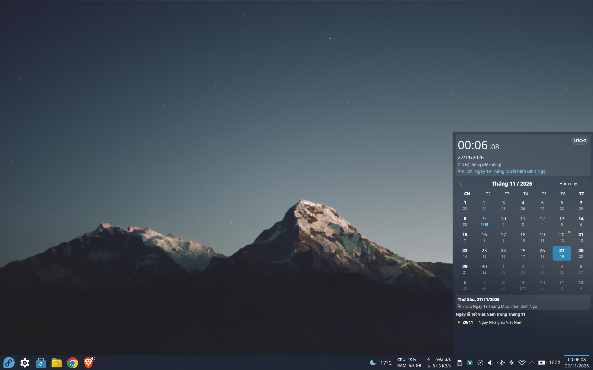
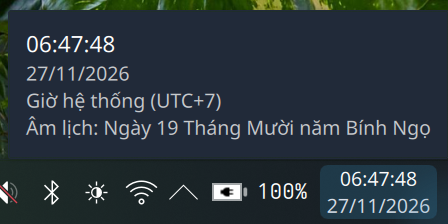
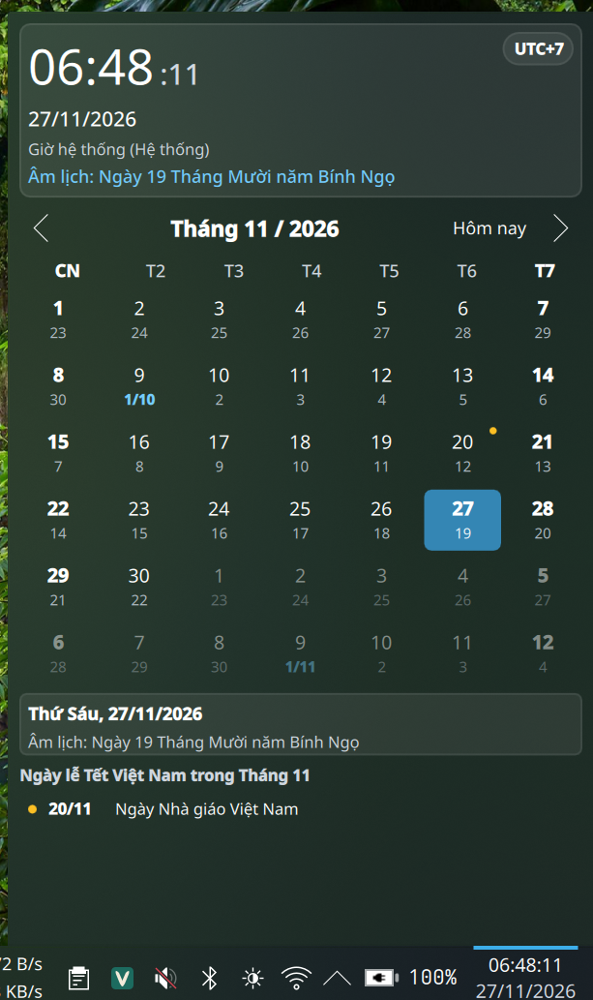

# Modern Clock & Calendar (KDE Plasma 6 Widget)

Widget đồng hồ & lịch hiện đại cho KDE Plasma 6 (hỗ trợ tùy chỉnh múi giờ, định dạng ngày giờ, phông chữ trên taskbar và lịch Âm & ngày lễ Tết Việt Nam).

## Ảnh chụp màn hình / Screenshots



| Di chuột / Hover | Chi tiết / Popup |
| :---: | :---: |
|  |  |

## Tính năng chính / Features

- **Hiển thị giờ & múi giờ linh hoạt (Flexible Time & Timezone):**
  - Chuyển đổi linh hoạt hệ giờ `24h` hoặc `12h` (AM/PM), tùy chọn hiển thị giây.
  - Tự động lấy múi giờ theo hệ thống hoặc tùy chỉnh sang bất kỳ múi giờ IANA nào (`Asia/Ho_Chi_Minh`, `Asia/Tokyo`, `America/New_York`...) kèm kiểm tra hợp lệ trực tiếp.
- **Định dạng ngày & giao diện taskbar (Date Format & Taskbar Appearance):**
  - Nhiều mẫu ngày tháng có sẵn và hỗ trợ nhập định dạng tùy chỉnh (`dd`, `MM`, `yyyy`, `ddd`, `dddd`, `MMM`, `MMMM`...) có xem trước trực tiếp.
  - Tùy chọn hiển thị ngày trên panel; tùy chỉnh phông chữ, cỡ chữ (tự động vừa chiều cao panel hoặc chỉnh tay), kiểu chữ đậm/nghiêng riêng cho giờ và ngày.
- **Lịch Việt Nam & Ngày lễ Tết (Vietnamese Lunar Calendar & Holidays):**
  - Tùy chọn hiển thị Âm lịch Việt Nam (UTC+7, thuật toán thiên văn học) và các ngày lễ Tết Việt Nam (Tết Dương lịch, Đêm Giao thừa, Tết Nguyên Đán, Giỗ Tổ Hùng Vương 10/3 ÂL, 30/4, 1/5, Quốc khánh 2/9, Rằm tháng Giêng, Phật Đản, Vu Lan, Trung Thu, 20/10, 20/11, Ông Công Ông Táo...).
  - Tùy chỉnh ngày bắt đầu của tuần (Chủ Nhật đến Thứ Bảy, mặc định Thứ Hai) kèm tùy chọn hiển thị số tuần ISO.
- **Popup chống tràn thông minh (Smart Overflow-Safe Popup):**
  - Tự động tính toán khoảng trống khả dụng so với mép màn hình và vị trí panel (`TopEdge`, `BottomEdge`, `LeftEdge`, `RightEdge`, `Floating`), kẹp kích thước/vị trí trong vùng an toàn và tự động cuộn khi không gian hẹp.
- **Song ngữ Anh / Việt (English & Vietnamese):**
  - Mặc định tự động nhận diện ngôn ngữ hệ điều hành, tự động fallback sang tiếng Anh nếu hệ điều hành dùng ngôn ngữ khác.
  - Có thể chọn thủ công Tiếng Việt hoặc English trong phần cài đặt.

## Cài đặt / Cập nhật / Gỡ bỏ

```bash
# Cài đặt lần đầu
./install.sh

# Cập nhật sau khi chỉnh sửa source (tự động reload plasmashell; thêm --no-restart nếu không muốn restart, hoặc --preview để xem trước)
./update.sh

# Gỡ bỏ hoàn toàn
./uninstall.sh
```

Hoặc dùng trực tiếp `kpackagetool6` / `plasmawindowed`:

```bash
kpackagetool6 --type Plasma/Applet --install .
kpackagetool6 --type Plasma/Applet --upgrade .
kpackagetool6 --type Plasma/Applet --remove com.modernclock.plasma6
plasmawindowed com.modernclock.plasma6
```

## Ghi công & Giấy phép / Credits & Licenses

- **Vietnamese Lunar Calendar Algorithm:** Astronomical calculation adapted from **Ho Ngoc Duc** (UTC+7 Vietnam standard time).
- **Widget License:** Copyright (C) 2026 [duynguyenvp](https://github.com/duynguyenvp) — [GNU General Public License v3.0 or later (GPL-3.0-or-later)](LICENSE).
- **Repository:** [github.com/duynguyenvp/kde-modern-clock](https://github.com/duynguyenvp/kde-modern-clock)
