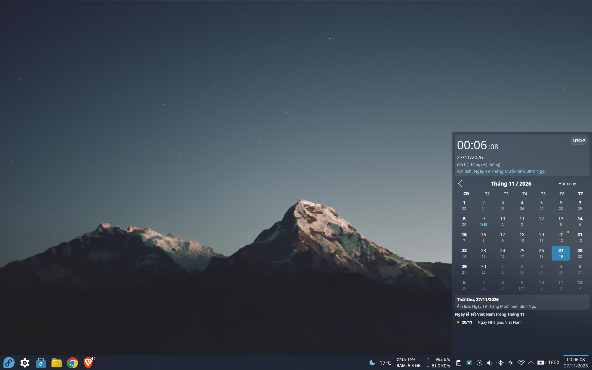
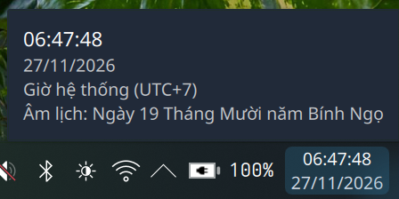
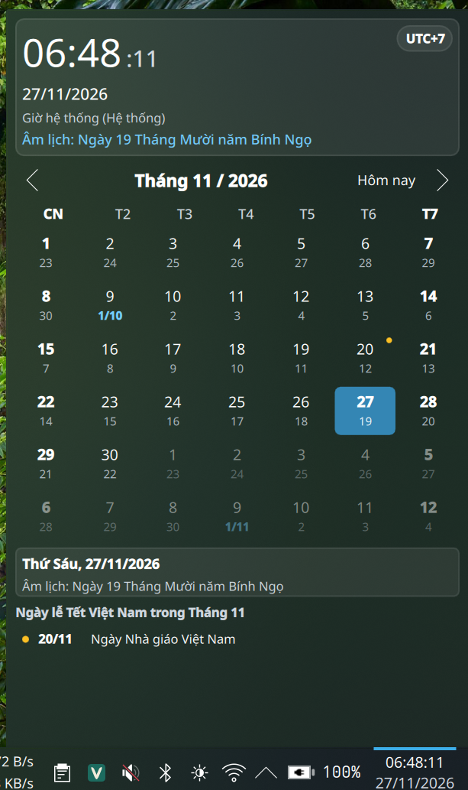

# Modern Clock & Calendar (KDE Plasma 6 Widget)

**English** | [Tiếng Việt](README.md)

A modern digital clock and calendar widget for KDE Plasma 6 featuring customizable timezones, date/time formats, taskbar typography, and Vietnamese Lunar Calendar & holidays.

## Screenshots



| Hover | Popup |
| :---: | :---: |
|  |  |

## Features

- **Flexible Time & Timezone:**
  - Switch between `24h` and `12h` (AM/PM) formats, with an option to display seconds.
  - Automatically uses the system timezone or any custom IANA timezone (`Asia/Ho_Chi_Minh`, `Asia/Tokyo`, `America/New_York`, etc.) with live validation.
- **Date Format & Taskbar Appearance:**
  - Multiple built-in date presets plus custom format support (`dd`, `MM`, `yyyy`, `ddd`, `dddd`, `MMM`, `MMMM`, etc.) with live preview.
  - Toggle date visibility on the panel, switch between **2 lines (stacked — default)** and **1 line (inline)** layouts with live preview, and customize font family, font size (auto-fit panel height or manual), and bold/italic styles independently for time and date.
- **Vietnamese Lunar Calendar & Holidays:**
  - Optional Vietnamese Lunar Calendar (UTC+7 astronomical calculation) and Vietnamese holidays (New Year's Day, Lunar New Year's Eve, Tet, Hung Kings' Commemoration Day 10/3 Lunar, Reunification Day 30/4, Labor Day 1/5, National Day 2/9, Lantern Festival, Vesak, Vu Lan, Mid-Autumn Festival, 20/10, 20/11, Kitchen Gods Day, etc.).
  - Configurable first day of the week (Sunday to Saturday, defaults to Monday) with optional ISO week numbers.
- **Smart Overflow-Safe Popup:**
  - Automatically calculates available screen space relative to screen edges and panel position (`TopEdge`, `BottomEdge`, `LeftEdge`, `RightEdge`, `Floating`), clamping size/position within safe bounds and enabling scrolling in tight spaces.
- **Bilingual (English & Vietnamese):**
  - Automatically detects the OS language by default and falls back to English for other languages.
  - Manually switchable between English and Vietnamese in the widget settings.

## Installation / Update / Uninstall

```bash
# First-time installation
./install.sh

# Update after modifying source (reloads plasmashell; pass --no-restart to skip restart, or --preview to preview)
./update.sh

# Completely remove the widget
./uninstall.sh

# Build a .plasmoid package
./build.sh
```

Or use `kpackagetool6` / `plasmawindowed` directly:

```bash
kpackagetool6 --type Plasma/Applet --install .
kpackagetool6 --type Plasma/Applet --upgrade .
kpackagetool6 --type Plasma/Applet --remove com.modernclock.plasma6
plasmawindowed com.modernclock.plasma6
```

## Credits & Licenses

- **Vietnamese Lunar Calendar Algorithm:** Astronomical calculation adapted from **Ho Ngoc Duc** (UTC+7 Vietnam standard time).
- **Widget License:** Copyright (C) 2026 [duynguyenvp](https://github.com/duynguyenvp) — [GNU General Public License v3.0 or later (GPL-3.0-or-later)](LICENSE).
- **Repository:** [github.com/duynguyenvp/kde-modern-clock](https://github.com/duynguyenvp/kde-modern-clock)
